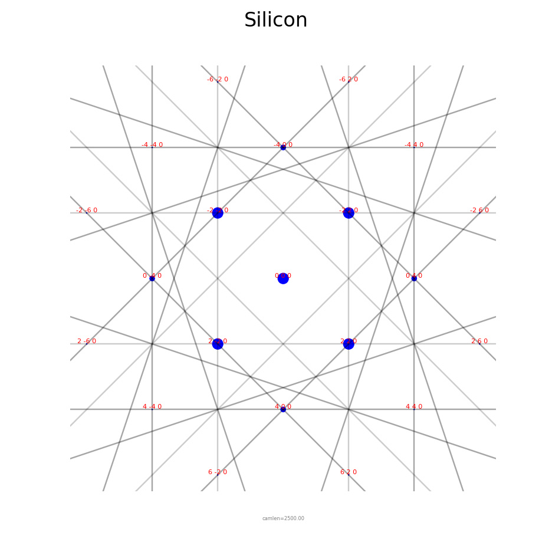

Get Started
===========

.. _installation:

Install
-------

pyEMAPS runs on 64-bit Windows with Python 3.12, 3.13, 3.14 or 3.15. 8 GB of RAM or more is
recommended. Install it in its own environment, so its dependencies don't clash with your
other packages:

.. tab-set::

   .. tab-item:: pip

      .. code-block:: console

         python -m venv .venv
         .venv\Scripts\activate
         pip install pyemaps

   .. tab-item:: conda

      .. code-block:: console

         conda create -n pyemaps python=3.12
         conda activate pyemaps
         pip install pyemaps

pip also installs NumPy (2.0 or later), matplotlib (3.8.4 or later) and *emaps*, the compiled
simulation backend built for your Python version. On Python 3.7, pip installs pyEMAPS 1.1.x.
If the installation fails, see :doc:`faq`.

Check the installation
----------------------

.. code-block:: console

   pyemaps --version
   pyemaps --sample

``--version`` prints the pyEMAPS version, and ``--sample`` runs short kinematic and dynamic
simulations of Silicon and shows the results. Its plot windows close by themselves.

Your first diffraction pattern
------------------------------

Every simulation starts from a :py:class:`~pyemaps.crystals.Crystal`. Load Silicon from the
built-in library, generate its kinematic diffraction pattern with the default settings, and
show it:

.. code-block:: python

   from pyemaps import Crystal, DPList, showDif

   if __name__ == '__main__':
       silicon = Crystal.from_builtin('Silicon')
       emc, pattern = silicon.generateDP()

       patterns = DPList('Silicon')
       patterns.add(emc, pattern)
       showDif(patterns)

*emc* holds the microscope and simulation controls that were used, and *pattern* is the
diffraction pattern: its Kikuchi lines, HOLZ lines and diffracted beams.

.. note::

   Keep the ``if __name__ == '__main__':`` line in scripts. The ``show`` functions draw in a
   separate process, and on Windows that process re-runs your script. Without the line,
   Python stops with a ``RuntimeError`` about the bootstrapping phase. Jupyter notebooks
   don't need it.

Next steps
----------

.. grid:: 1 2 2 2
   :gutter: 2

   .. grid-item-card:: Explore the features
      :link: user_guide/index
      :link-type: doc

      Kinematic and dynamic diffraction, stereodiagrams, crystals, and 4D-STEM indexing.

   .. grid-item-card:: Run the sample scripts
      :link: examples
      :link-type: doc

      ``pyemaps -cp`` copies them into a *pyemaps_samples* folder.

   .. grid-item-card:: Set up your data folder
      :link: user_guide/configuration
      :link-type: doc

      Where pyEMAPS reads crystals and saves results.

   .. grid-item-card:: Activate a license
      :link: user_guide/configuration
      :link-type: doc

      For 4D-STEM indexing, database generation and other extended features.
