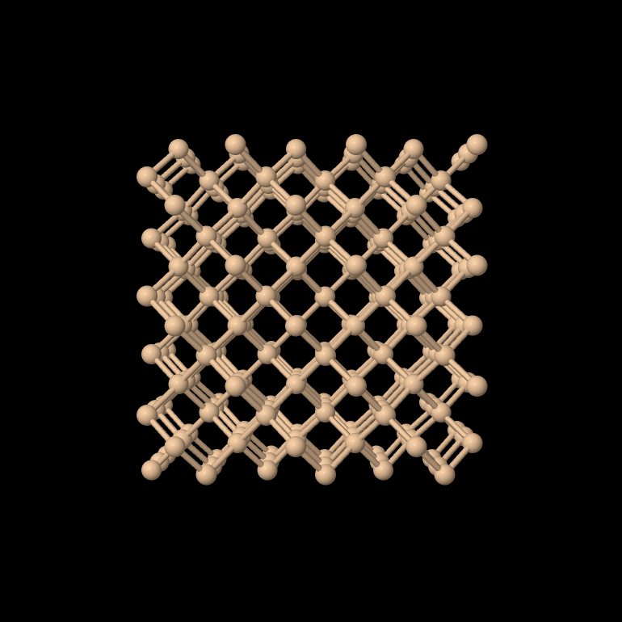

Crystals
========

Every pyEMAPS simulation and calculation starts from a :py:class:`~pyemaps.crystals.Crystal`
object loaded with crystal data. This example loads Silicon from the built-in crystal library
with :py:meth:`~pyemaps.crystals.Crystal.from_builtin`:

.. code-block:: python

   from pyemaps import Crystal

   si = Crystal.from_builtin('Silicon')

The crystal is then ready for simulations and calculations.

Crystals can also be loaded from your own data:

* :py:meth:`~pyemaps.crystals.Crystal.from_xtl`: an EMAPS ``.xtl`` file
* :py:meth:`~pyemaps.crystals.Crystal.from_cif`: a CIF file
* :py:meth:`~pyemaps.crystals.Crystal.from_json`: a JSON file
* :py:meth:`~pyemaps.crystals.Crystal.from_dict`: a Python dictionary

A file name without a folder is looked for in the current working directory, then in the data
folder. See :doc:`configuration`.

Built-in crystals
-----------------

:py:meth:`~pyemaps.crystals.Crystal.list_all_builtin_crystals` returns the names of the built-in
crystals:

.. code-block:: python

   from pyemaps import Crystal

   print(Crystal.list_all_builtin_crystals())

The library has 44 crystals:

::

   'Aluminium', 'AluminiumOxide', 'Aluminium_FCC', 'BariumTitanate_180k', 'BariumTitanate_270k',
   'BariumTitanate_Tetra', 'BiMnO3', 'Boron_Tetra', 'CadmiumSelenide_Hex', 'CadmiumSulfide_Cubic',
   'CadmiumSulfide_Hex', 'Chromium_BCC', 'CopperOxide', 'Copper_FCC', 'CoSb3_Skutterudite',
   'Cu2O_Cuprite', 'Diamond', 'ErbiumPyrogermanate', 'FePd_Tetra', 'FeS2_Pyrite',
   'GalliumAntimonide', 'GalliumArsenide', 'GalliumNitride', 'Germanium', 'Gold_FCC',
   'IndiumArsenide', 'LaMnO3', 'LeadZirconateTitanate', 'Li2MnO3', 'limno2', 'NaFeO2', 'Nb3Sn',
   'Pentacene', 'Silicon', 'StrontiumTitanate', 'TelluriumDioxide', 'TinDioxide_RT',
   'TitaniumDioxide_Anatase', 'TitaniumDioxide_Rutile', 'TungstenDiselenide', 'VanadiumDioxide_RT',
   'ZincOxide', 'Zinc_HCP', 'ZirconiumNitride'

Constructing crystal structures
-------------------------------

:py:meth:`~pyemaps.crystals.Crystal.generateMxtal` builds a block of the crystal's atomic
structure (a supercell) from its unit cell, and
:py:meth:`~pyemaps.crystals.Crystal.writeXYZ` saves it as an ``.xyz`` file:

.. code-block:: python

   from pyemaps import Crystal

   si = Crystal.from_builtin('Silicon')
   mx = si.generateMxtal()
   si.writeXYZ(mx)

The file is saved in the *mxtal* subfolder of the data folder. Tools such as
`Jmol <https://jmol.sourceforge.net/>`_ can import it to show the structure in 3D:

