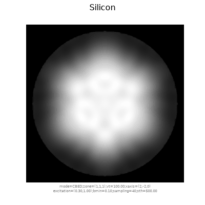
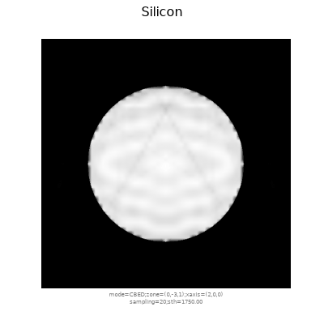
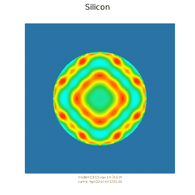

Dynamic diffraction (Bloch wave)
================================

pyEMAPS simulates dynamic diffraction with the Bloch wave method, so this guide also calls it
the Bloch simulation.

.. code-block:: python

    from pyemaps import Crystal, showBloch

    if __name__ == '__main__':
        silicon = Crystal.from_builtin('Silicon')

        # A Bloch simulation with the default controls, except for the sampling.
        try:
            images = silicon.generateBloch(sampling=20)
        except Exception as e:
            print(f'The Bloch simulation failed: {e}')
        else:
            showBloch(images)                 # grey scale
            showBloch(images, bColor=True)    # with a color map

:py:meth:`~pyemaps.crystals.Crystal.generateBloch` runs a Bloch wave simulation, here with 20
sampling points along the disk radius instead of the default 8. For all its controls and
parameters, see :py:meth:`~pyemaps.crystals.Crystal.generateBloch`.

It returns the images as a :py:class:`BImgList <pyemaps.ddiffs.BlochImgs>`, and
:py:func:`~pyemaps.display.showBloch`, from the :py:mod:`display module <pyemaps.display>`,
shows them.

.. note::

   *generateBloch* can make images at a range of sample thicknesses (*sample_thickness*), and
   save them in a raw image file (*bSave*). Third-party tools such as
   `ImageJ <https://imagej.net/ij/>`_ and
   `DigitalMicrograph <https://www.gatan.com/products/tem-analysis/gatan-microscopy-suite-software>`_
   can import the file. See :doc:`third_party`.

.. note::

   For the scattering matrix and other details of a simulation, start a session with
   :py:meth:`~pyemaps.crystals.Crystal.beginBloch`, then call
   :py:meth:`~pyemaps.crystals.Crystal.getSCMatrix`, and end the session with
   :py:meth:`~pyemaps.crystals.Crystal.endBloch`.

See :doc:`crystals` for the built-in crystals you can simulate.

Displaying a series of images
-----------------------------

This example makes Bloch images of Silicon at six sample thicknesses and shows them as a
table:

* zone axis (1, 1, 1)
* accelerating voltage 100 kV
* sample thickness from 500 to 1750 Å, every 250 Å
* 40 sampling points along the disk radius

The animation goes through the same thickness range in finer steps, every 50 Å:

.. The animations on this page are made by docs/scripts/guide_animations.py.

.. code-block:: python

    from pyemaps import EMC, SIMC, Crystal, showBloch

    def generate_bloch_images(name='Silicon'):
        """Generate Bloch images at six sample thicknesses, or return None on failure."""
        crystal = Crystal.from_builtin(name)

        emc = EMC(zone=(1, 1, 1), vt=100, cl=1000,
                  simc=SIMC(excitation=(0.3, 1.0), bmin=0.1))
        try:
            images = crystal.generateBloch(sampling=40,
                                           em_controls=emc,
                                           sample_thickness=(500, 1750, 250))    # Å
        except Exception as e:
            print(f'The Bloch simulation failed: {e}')
            return None

        images.sort()
        return images

    if __name__ == '__main__':
        images = generate_bloch_images()
        if images is not None:
            showBloch(images, cShow=True, layout='table', bSave=True)

Zone axis and tilt
------------------

The zone axis (*zone*) and the sample tilt (*tilt*, about the x and y axes, in degrees) are
microscope controls, set in :py:class:`EMC <pyemaps.emcontrols.EMControl>`:

.. code-block:: python

    from pyemaps import EMC, Crystal, showBloch

    if __name__ == '__main__':
        silicon = Crystal.from_builtin('Silicon')

        emc = EMC(zone=(0, 1, 1), tilt=(0.5, 0.0), cl=1000)
        images = silicon.generateBloch(sampling=20, em_controls=emc,
                                       sample_thickness=(1750, 1750, 100))
        showBloch(images, bColor=True)

The sample *si_bloch.py* makes a series of each in parallel processes. The animations show
Silicon 1750 Å thick at the zone axes (0, i, 1) for i from -3 to 2, and at the [001] zone axis
tilting about x, from 0 to 1.5 degrees, to -1.5 and back, then the same about y:

