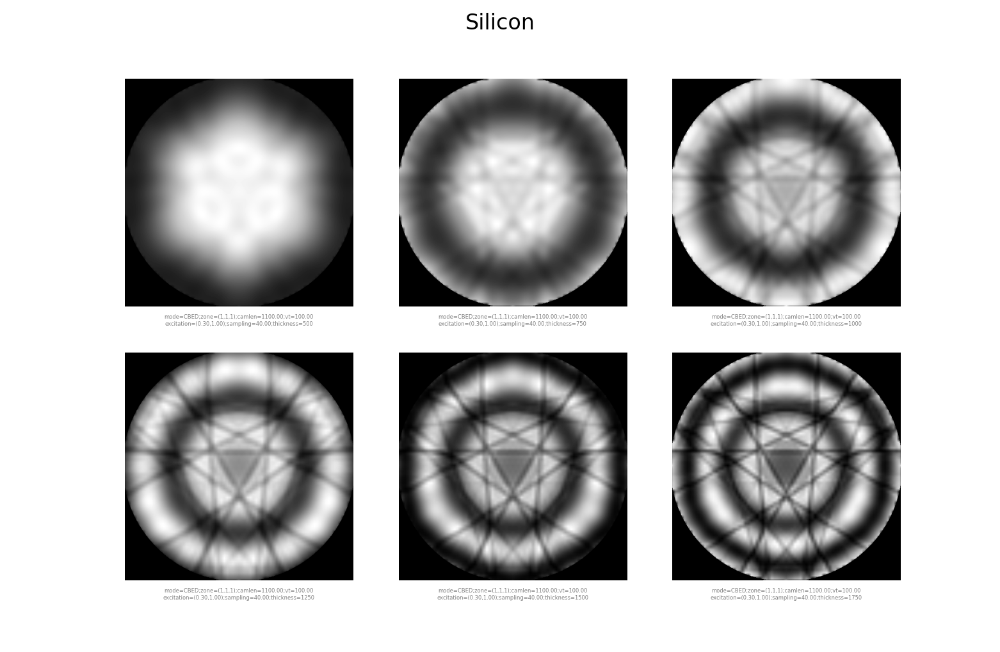

Dynamic diffraction (Bloch wave)
================================

pyEMAPS simulates dynamic diffraction with the Bloch wave method, so this guide also calls it
the Bloch simulation.

.. code-block:: python

    from pyemaps import Crystal as cr        # Crystal class
    from pyemaps import showBloch            # Builtin visualization helper function

    if __name__ == '__main__':
        # create a crystal class object and load it with builtin silicon data
        c_name = 'Silicon'
        si = cr.from_builtin(c_name)

        # Generate dynamic diffraction patterns using pyEMAPS' bloch module
        # with all other default parameters except sampling
        try:
            bloch_imgs_list = si.generateBloch(sampling = 20)

        except Exception as e:
            print(f'Error: {e}')

        else:
            showBloch(bloch_imgs_list)               # grey color map
            showBloch(bloch_imgs_list, bColor=True)  # with predefined color map
   
:py:meth:`~pyemaps.crystals.Crystal.generateBloch` runs a Bloch wave simulation, here with 20
sampling points along the disk radius instead of the default 8. For all its controls and
parameters, see :py:meth:`~pyemaps.crystals.Crystal.generateBloch`.

It returns the images as a :py:class:`BImgList <pyemaps.ddiffs.BlochImgs>`, and
:py:func:`~pyemaps.display.showBloch`, from the :py:mod:`display module <pyemaps.display>`,
shows them.

.. note::

   *generateBloch* can make images at a range of sample thicknesses (*sample_thickness*), and
   save them in a raw image file (*bSave*). Third-party tools such as
   `ImageJ <https://imagej.net/ij/>`_ and
   `DigitalMicrograph <https://www.gatan.com/products/tem-analysis/gatan-microscopy-suite-software>`_
   can import the file. See :doc:`third_party`.

.. note::

   For the scattering matrix and other details of a simulation, start a session with
   :py:meth:`~pyemaps.crystals.Crystal.beginBloch`, then call
   :py:meth:`~pyemaps.crystals.Crystal.getSCMatrix`, and end the session with
   :py:meth:`~pyemaps.crystals.Crystal.endBloch`.

See :doc:`crystals` for the built-in crystals you can simulate.

Displaying a series of images
-----------------------------

This example makes Bloch images of Silicon at six sample thicknesses and shows them as a
table:

* zone axis (1, 1, 1)
* accelerating voltage 100 kV
* sample thickness from 500 to 1750 Å, every 250 Å
* 40 sampling points along the disk radius

.. code-block:: python

    from pyemaps import EMC

    def generate_bloch_images(name = 'Silicon'):
        
        from pyemaps import Crystal as cryst
        from pyemaps import SIMC

        cr = cryst.from_builtin(name)
        
        vt = 100
        sth = (500, 1750, 250)
        simc = SIMC(excitation=(0.3,1.0), bmin=0.1)
    
        try:
            bimgs = cr.generateBloch(sampling = 40,
                                    em_controls = EMC(zone=(1,1,1),
                                    vt=vt,
                                    cl=1000,
                                    simc=simc),
                                    sample_thickness = sth
                                    )
        except Exception as e:
            print(f'Generated an exception: {e}')
            return None

        bimgs.sort()
        return bimgs 

    if __name__ == '__main__':
        
        from pyemaps import showBloch

        imgs = generate_bloch_images()
        if imgs is not None:
            showBloch(imgs, cShow=True, layout='table', bSave = True)
