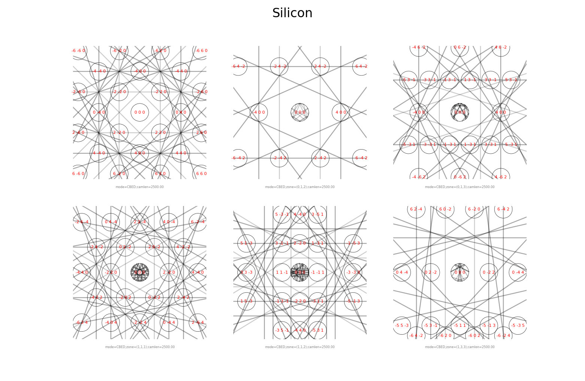

Kinematic diffraction
=====================

.. code-block:: python

   from pyemaps import Crystal, DPList, showDif

   if __name__ == '__main__':    # needed in scripts; see the note below
       silicon = Crystal.from_builtin('Silicon')

       # emc: the microscope and simulation controls used; pattern: the diffraction pattern
       emc, pattern = silicon.generateDP()
       print(pattern)

       patterns = DPList('Silicon')    # a list of patterns to display
       patterns.add(emc, pattern)
       showDif(patterns)

.. note::

   Keep the ``if __name__ == '__main__':`` line in scripts. *showDif*, *showBloch* and
   *showStereo* draw in a separate process, and on Windows that process re-runs your script.
   Without the line, Python stops with a ``RuntimeError`` about the bootstrapping phase.
   Jupyter notebooks don't need it.

:py:meth:`~pyemaps.crystals.Crystal.generateDP` returns the microscope and simulation controls
it used (*emc*) and the kinematic diffraction pattern (*pattern*), a
:py:class:`~pyemaps.kdiffs.diffPattern`. Called without arguments, it uses the default controls.
For all its parameters, see :py:meth:`~pyemaps.crystals.Crystal.generateDP`.

:py:func:`~pyemaps.display.showDif`, from the :py:mod:`display module <pyemaps.display>`, shows
the patterns in a :py:class:`DPList <pyemaps.kdiffs.Diffraction>`. Its options show or hide the
Kikuchi lines (*kShow*), the Miller indices of the diffracted beams (*iShow*) and the non-default
controls (*cShow*).

Displaying a series of patterns
-------------------------------

This example makes CBED patterns of Silicon at six zone axes, with a camera length of 2500 mm.
It runs the simulations in parallel processes, then shows the patterns as a table:

.. code-block:: python

    import concurrent.futures
    import sys

    from pyemaps import EMC, Crystal, DPList, showDif

    ZONES = [(0, 0, 1), (1, 1, 2), (1, 1, 1), (1, 3, 3), (0, 1, 2), (0, 1, 3)]
    MAX_WORKERS = 4    # number of parallel processes

    def generate_kinematic_patterns(name='Silicon', mode=2):
        """Generate kinematic diffraction patterns at each zone axis in ZONES, in parallel."""
        crystal = Crystal.from_builtin(name)

        patterns = DPList(name, mode=mode)
        with concurrent.futures.ProcessPoolExecutor(max_workers=MAX_WORKERS) as executor:
            futures = [executor.submit(crystal.generateDP, mode=mode,
                                       em_controls=EMC(zone=zone, cl=2500))
                       for zone in ZONES]

            for future in concurrent.futures.as_completed(futures):
                try:
                    emc, pattern = future.result()
                except Exception as e:
                    sys.exit(f'Failed to generate a diffraction pattern: {e}')
                patterns.add(emc, pattern)

        patterns.sort()
        return patterns

    if __name__ == '__main__':
        patterns = generate_kinematic_patterns(mode=2)    # 2: CBED mode
        showDif(patterns, cShow=True, iShow=True, layout='table', bSave=True)
