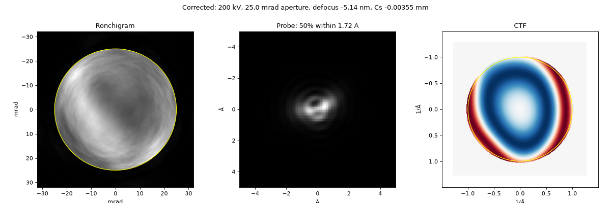
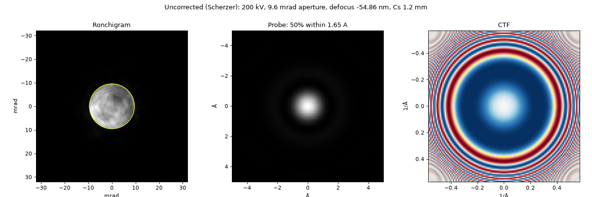

Electron probes and Ronchigrams
===============================

A STEM probe is the image of the aperture that the probe-forming lens focuses on the sample.
Its size and shape depend on the high voltage, the aperture and the lens's aberrations: the
defocus, the spherical aberration Cs (C3) and, in a corrected lens, C5 and the residual
aberrations the corrector measures. :py:class:`~pyemaps.probe.Probe` computes:

- the **Ronchigram**: the shadow image of the probe through a thin sample, the pattern a
  corrector is tuned on;
- the **probe** intensity in the sample plane, and its diameter;
- the **contrast transfer function** (CTF), with its coherence envelopes.

This feature needs no license.

.. code-block:: python

   from pyemaps import Probe

   corrector = {'a1': (1.349, 146.2), 'a2': (58.94, -131.9), 'b2': (22.89, 141.4)}
   probe = Probe(kv=200, aperture=25, defocus=-5.14, cs=-0.00355, c5=3.829,
                 aberrations=corrector, size=100, sampling=256)

   ronchigram = probe.ronchigram()      # of 100 Å of amorphous aluminium
   intensity = probe.probe()            # normalized to a sum of 1
   ctf = probe.ctf()

   probe.show(ronchigram, 'ronchigram')
   print(f'{probe.diameter(50):.2f} Å')   # the diameter holding half the intensity

The sample *ronchigram.py* runs this for a corrected lens with all nine residual aberrations,
and for an uncorrected one at its Scherzer settings:

The settings
------------

A :py:class:`~pyemaps.probe.Probe` takes the settings as keyword arguments, all optional, and
keeps them as attributes you can change between calculations:

- *kv*: the high voltage, in kV;
- *aperture*: the aperture semi-angle, in mrad. :py:attr:`~pyemaps.probe.Probe.kmax` gives it
  in 1/Å;
- *defocus*, in nm, negative for underfocus; *cs* and *c5*, in mm;
- *cc*, in mm, and *energy_spread*, in eV: with Cc of 0.01 mm or more, the probe is the sum
  of the probes over the energy spread, and the CTF has its temporal coherence envelope;
- *semi_angle*: the illumination semi-angle, in mrad, for the CTF's spatial coherence
  envelope;
- *tilt*: the beam tilt, amplitude in mrad and direction in degrees; *rotation*: the
  rotation of the residual aberrations, in degrees;
- *aberrations*: the residual aberrations, ``{name: (amplitude, angle)}``, or one at a time
  with :py:meth:`~pyemaps.probe.Probe.set_aberration`. Two-fold astigmatism a1, three-fold
  a2 and coma b2 are in nm; a3, a4, s3, b4 and d4 in µm; a5 in mm.

The map
-------

Results are computed on a square map *size* Å across, with *sampling* x *sampling* pixels:

- the probe and the sample's potential are in real space, with pixels of
  ``size / sampling`` Å;
- the Ronchigram and the CTF are in reciprocal space, with pixels of ``1 / size`` 1/Å. The
  Ronchigram reaches ``1000 * wavelength * sampling / (2 * size)`` mrad from its center.

So the map has to be large for the Ronchigram to reach beyond the aperture, and its pixels
small for the probe: 100 Å with 256 pixels gives a Ronchigram out to 32 mrad at 200 kV, with
0.39 Å pixels. :py:meth:`~pyemaps.probe.Probe.diameter` counts whole pixels, so compute the
probe for it on a finer map, with pixels of about 0.1 Å:

.. code-block:: python

   probe.size = 25.6
   print(f'{probe.diameter(50):.2f} Å')

:py:meth:`~pyemaps.probe.Probe.show` displays a result with its axes in Å, mrad or 1/Å, and
:py:meth:`~pyemaps.probe.Probe.extent` gives those axes for your own plots.

The sample
----------

:py:meth:`~pyemaps.probe.Probe.ronchigram` takes the sample's projected potential, a
*sampling* x *sampling* array over the map. By default, it's
:py:meth:`~pyemaps.probe.Probe.random_potential`: 100 Å of amorphous aluminium, 0.05 atoms
per ų, with a random number seed that makes it the same every time. Change the density, the
atomic number, the thickness or the seed there, or pass a potential of your own.

Optimum settings
----------------

- :py:meth:`~pyemaps.probe.Probe.scherzer` sets the Scherzer defocus and aperture of an
  uncorrected lens, from Cs.
- :py:meth:`~pyemaps.probe.Probe.haider` sets the defocus and Cs that balance C5 in a
  corrected lens, and the aperture, after Haider et al., *Ultramicroscopy* (2000).

.. code-block:: python

   uncorrected = Probe(kv=200, cs=1.2, size=25.6, sampling=256)
   uncorrected.scherzer()    # defocus -54.9 nm, aperture 9.56 mrad
   print(f'{uncorrected.diameter(50):.2f} Å')

Microscope files
----------------

:py:meth:`Probe.from_file <pyemaps.probe.Probe.from_file>` reads the settings from a probe
program parameter file: lines such as ``kv 200``, ``df -5.14``, ``cs -0.00355`` or
``a1 1.349 146.2``. Settings the file doesn't have can be given as keyword arguments:

.. code-block:: python

   probe = Probe.from_file('titan.txt', aperture=25, size=100, sampling=256)

The calculations come from the probe program by J. M. Zuo, now part of emaps.
