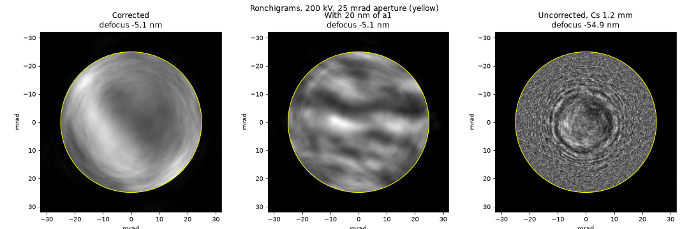
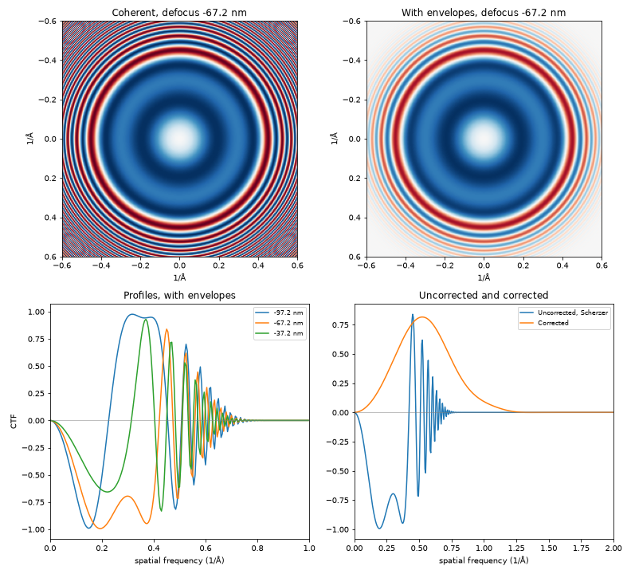
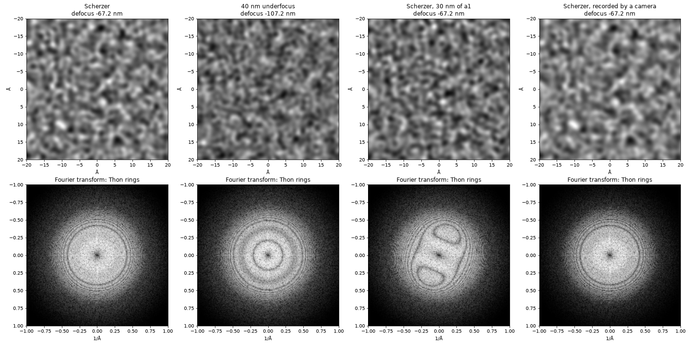

Probes, Ronchigrams, CTF and HREM
=================================

A lens adds a phase error χ(k) to the part of the electron wave travelling at each spatial
frequency k: from the defocus, the spherical aberration Cs (C3) and C5, and in a real lens the
residual aberrations a corrector measures. :py:class:`~pyemaps.probe.Probe` holds such a lens
and computes what it does, in four modes:

- **Ronchigram**: the shadow image of a convergent probe through a thin amorphous sample, the
  pattern correctors are aligned on;
- **Probe**: the STEM probe's intensity in the sample plane, and its diameter;
- **CTF**: the contrast transfer function of an objective lens, with its coherence envelopes;
- **HREM**: the high-resolution TEM image of a thin sample.

This feature needs no license.

.. seealso::

   The notebook :doc:`../notebooks/probe` explains the physics and runs all four modes step by
   step, shown here with its plots and output.

.. toctree::
   :hidden:

   ../notebooks/probe

The lens
--------

.. code-block:: python

   from pyemaps import Probe

   corrector = {'a1': (1.349, 146.2), 'a2': (58.94, -131.9), 'b2': (22.89, 141.4)}
   lens = Probe(kv=200, aperture=25, defocus=-5.14, cs=-0.00355, c5=3.829,
                aberrations=corrector, size=100, sampling=256)
   print(lens)

A :py:class:`~pyemaps.probe.Probe` takes its settings as keyword arguments, all optional, and
keeps them as attributes you can change between calculations:

- *kv*: the high voltage, in kV;
- *aperture*: the aperture semi-angle, in mrad: the probe's convergence angle, or the objective
  aperture for HREM. :py:attr:`~pyemaps.probe.Probe.kmax` gives it in 1/Å;
- *defocus*, in nm, negative for underfocus; *cs* and *c5*, in mm;
- *cc*, in mm, and *energy_spread*, in eV, for the chromatic aberration;
- *semi_angle*: the illumination semi-angle, in mrad, for the spatial coherence of the CTF and
  HREM images;
- *tilt*: the beam tilt, amplitude in mrad and direction in degrees; *rotation*: the
  rotation of the residual aberrations, in degrees;
- *aberrations*: the residual aberrations, ``{name: (amplitude, angle)}``, or one at a time
  with :py:meth:`~pyemaps.probe.Probe.set_aberration`. Two-fold astigmatism a1, three-fold
  a2 and coma b2 are in nm; a3, a4, s3, b4 and d4 in µm; a5 in mm.

:py:meth:`Probe.from_file <pyemaps.probe.Probe.from_file>` reads the settings from a probe
program parameter file, with lines such as ``kv 200``, ``df -5.14`` or ``a1 1.349 146.2``.

**The map.** Results are computed on a square map *size* Å across, with *sampling* x
*sampling* pixels. The probe, the sample and HREM images are in real space, with pixels of
``size / sampling`` Å. The Ronchigram and the CTF are in reciprocal space, with pixels of
``1 / size`` 1/Å; a Ronchigram reaches ``1000 * wavelength * sampling / (2 * size)`` mrad from
its center. :py:meth:`~pyemaps.probe.Probe.show` displays any result with its axes, and
:py:meth:`~pyemaps.probe.Probe.extent` gives those axes for your own plots. The sampling can be
up to 32768 pixels, as memory allows.

**The aberration function.** :py:meth:`~pyemaps.probe.Probe.phase_map` returns χ(k) itself, in
radians, the phase the lens adds at each spatial frequency. Where it stays within about π/4 of
its value at the center, the lens is free of aberrations; that region sets how large an aperture
can be used. ``lens.show(lens.phase_map(), 'phase')`` draws it with the aperture.

Ronchigram
----------

:py:meth:`~pyemaps.probe.Probe.ronchigram` takes the sample's projected potential, a
*sampling* x *sampling* array. By default, it's
:py:meth:`~pyemaps.probe.Probe.random_potential`: 100 Å of amorphous aluminium, 0.05 atoms
per ų, with a fixed random number seed. Change the density, atomic number, thickness or seed
there, or pass a potential of your own.

.. code-block:: python

   lens.show(lens.ronchigram(), 'ronchigram')

The map has to be large for the Ronchigram to reach beyond the aperture: 100 Å with 256 pixels
reaches 32 mrad at 200 kV. The sample *ronchigram.py* compares a corrected probe, the same with
two-fold astigmatism, and an uncorrected one, with the phase map behind each:

The Ronchigram doesn't include the chromatic aberration.

Probe
-----

:py:meth:`~pyemaps.probe.Probe.probe` returns the probe's intensity, normalized to a sum of 1.
With *cc* of 0.01 mm or more, it's the sum of the probes over the energy spread.
:py:meth:`~pyemaps.probe.Probe.diameter` gives the diameter of the circle holding a share of
the intensity. It counts whole pixels, so compute the probe on a map with pixels much smaller
than the probe, such as 0.05 Å:

.. code-block:: python

   fine = Probe(kv=200, aperture=25, c5=3.829, size=25.6, sampling=512)
   fine.haider(optimum_aperture=False)     # the Cs and defocus that balance C5 at 25 mrad
   print(f'{fine.diameter(50):.2f} Å')     # 0.54 Å

Two methods set the optimum settings:

- :py:meth:`~pyemaps.probe.Probe.scherzer` sets the Scherzer defocus and aperture of an
  uncorrected lens, from Cs;
- :py:meth:`~pyemaps.probe.Probe.haider` sets the Cs and defocus that balance C5 in a corrected
  lens, and the aperture too unless you keep yours, after Haider et al., *Ultramicroscopy*
  (2000).

:py:meth:`~pyemaps.probe.Probe.optimize` searches for the defocus and residual aberrations
that make the probe smallest, as the probe program's optimize command did, with the
Nelder-Mead simplex method. It minimizes the diameter as ``diameter(interpolate=True)``
measures it, interpolating between pixels so that it changes smoothly:

.. code-block:: python

   fine.set_aberration('a1', 15.0, 40.0)                   # 15 nm of two-fold astigmatism
   result = fine.optimize(percent=50, vary=('defocus', 'a1'))
   print(result['diameter'], result['a1'])                 # a1 tuned back to about 0

**STEM images.** :py:meth:`~pyemaps.probe.Probe.stem_image` gives the incoherent (annular dark
field) STEM image of a sample: the probe's intensity convolved with its projected potential.
:py:meth:`~pyemaps.probe.Probe.mtf` gives the probe's modulation transfer function, the
amplitude of the Fourier transform of its intensity, which says how strongly each spatial
frequency of the sample shows in such an image.

:py:meth:`~pyemaps.probe.Probe.focal_series` computes a probe, Ronchigram, CTF, HREM or STEM
image, or phase map at each of a list of defocus values, as a stack.

The sample *stem_probe.py* compares an uncorrected probe at its Scherzer settings with a
corrected one at the Haider settings, with and without a corrector's measured residual
aberrations. It shows the uncorrected probe's size across defocus, the STEM images of a thin
amorphous sample and the probes' MTFs, then tunes out the measured astigmatism with
:py:meth:`~pyemaps.probe.Probe.optimize`:

.. image:: ../_static/images/probe_stem_probe.png
   :width: 100%

CTF
---

:py:meth:`~pyemaps.probe.Probe.ctf` returns sin χ, damped by the temporal coherence envelope
(from *cc* and *energy_spread*) and the spatial one (from *semi_angle*), within 80% of the map's
radius. It isn't cut off at the aperture. ``scherzer(mode=2)`` sets the Scherzer defocus for
phase contrast, where the CTF keeps one sign out to the point resolution.

.. code-block:: python

   tem = Probe(kv=200, cs=1.2, cc=1.5, energy_spread=0.7, semi_angle=0.2,
               size=200, sampling=1024)
   tem.scherzer(mode=2)
   ctf = tem.ctf()

An uncorrected lens's CTF oscillates fast at high frequencies, so it needs fine reciprocal
pixels, that is, a large map: 200 Å gives 0.005 1/Å. The sample *ctf.py* shows the CTF with
and without the envelopes, at and around the Scherzer defocus, and for a corrected lens:

HREM
----

:py:meth:`~pyemaps.probe.Probe.hrem` images a sample's exit wave through the lens, used as the
objective lens: the aperture, the aberrations and the coherence envelopes. The direct beam
passes unchanged. :py:meth:`~pyemaps.probe.Probe.exit_wave` gives the exit wave of a thin sample
from its projected potential, and an exit wave from a multislice program works too. With
``integrate=True``, the images are added up over the energy spread instead of damped by the
temporal envelope.

.. code-block:: python

   tem = Probe(kv=200, cs=1.2, cc=1.5, energy_spread=0.7, semi_angle=0.2,
               size=100, sampling=512)
   tem.scherzer(mode=2)
   tem.aperture = 20.0                     # the objective aperture
   carbon = tem.random_potential(density=0.1, z=6, thickness=50, seed=7)
   image = tem.hrem(tem.exit_wave(carbon))
   tem.show(image, 'hrem')

A camera blurs the image it records. :py:meth:`~pyemaps.probe.Probe.apply_psf` applies a
detector's point spread function, through its transfer function ``a / (1 + b w²) + 1 - a`` at
w cycles per pixel, as the probe program's psf command did. The defaults, *a* = 0.6 and
*b* = 400, are typical of a camera: they transfer about 0.4 at the Nyquist frequency.

.. code-block:: python

   recorded = tem.apply_psf(image)                     # a=0.6, b=400.0
   sharper = tem.apply_psf(image, a=0.3, b=400.0)      # a better camera

The image of an amorphous sample shows the CTF in its Fourier transform, as Thon rings. The
sample *hrem.py* shows images at the Scherzer defocus, further underfocus, with two-fold
astigmatism, which makes the rings elliptical, and as a camera records them:

The calculations come from the probe program by J. M. Zuo, now part of emaps.
