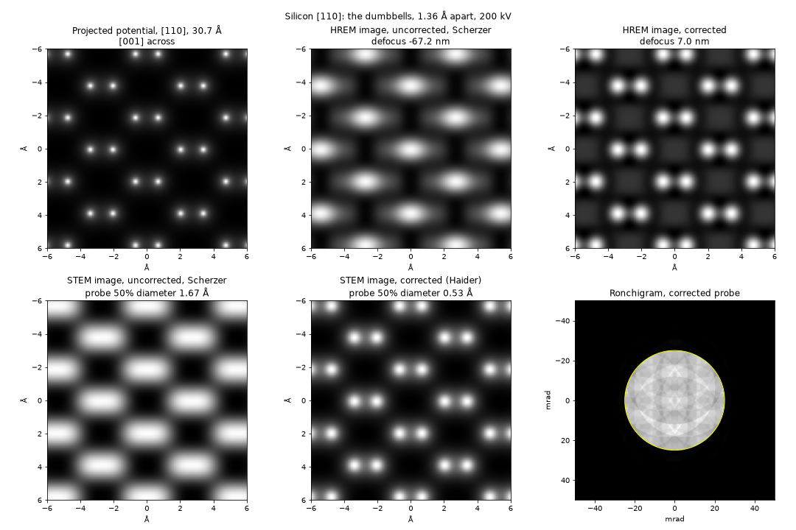

Crystal potentials
==================

The samples of the Ronchigrams, STEM images and HREM images can be a crystal instead of an
amorphous film.
:py:meth:`~pyemaps.probe.Probe.crystal_potential` builds the projected potential of a pyEMAPS
crystal along a zone axis: the atoms of a slab of the given thickness, each with its projected
atomic potential, added up. Pass it wherever a potential goes: to
:py:meth:`~pyemaps.probe.Probe.ronchigram`, :py:meth:`~pyemaps.probe.Probe.stem_image` or
:py:meth:`~pyemaps.probe.Probe.exit_wave`.

.. seealso::

   Step 7 of the step-by-step guide, the notebook :doc:`probe.ipynb <../../notebooks/probe>`, builds
   silicon's potential along [110], with its dumbbells, shown here with its plots and output.

.. code-block:: python

   from pyemaps import Crystal, Probe

   si = Crystal.from_builtin('Silicon')
   a = float(si.cell.a)
   lens = Probe(kv=200, size=12 * a, sampling=1024)
   potential = lens.crystal_potential(si, zone=(1, 1, 0), thickness=30)
   lens.show(potential, 'potential')

The unit cell is filled from the space group by
:py:meth:`~pyemaps.crystals.Crystal.generateMxtal`, and emaps computes the potential. Each
atom's potential comes from its electron scattering factor, as emaps' structure factors have
it, with its Debye–Waller factor and occupancy. The beam is along the zone axis. *x_axis* sets
the direction along the map's columns; by default, it's the shortest lattice direction
perpendicular to the zone axis. *shift* moves the crystal on the map.

Like the random potential, it's the whole slab projected onto one plane, so it suits thin
crystals: the electrons don't propagate through the thickness. For thicker crystals, see
:doc:`multislice`.

**Maps without a seam.** The map repeats itself at its edges. Unless its *size* is a whole
number of the crystal's repeats across and down, the crystal has a seam there, away from the
probe at the map's center. :py:meth:`~pyemaps.probe.Probe.crystal_repeats` gives those
repeats, centering included, and the map sizes that hold whole numbers of them.
``fit=True`` then strains the crystal very slightly in the plane of the map, so that it
repeats exactly at the map's edges:

.. code-block:: python

   lens.crystal_repeats(si, zone=(1, 1, 0), max_size=70)
   # {'x_axis': (0, 0, 1), 'repeats': ((0.0, 3.8401), (-5.4307, 0.0)),
   #  'period': 3.8401, 'sizes': [(65.168, 0.00173), (65.281, 0.00173)]}
   potential = lens.crystal_potential(si, zone=(1, 1, 0), thickness=30, fit=True)

Along [110] in silicon, with [001] across, the repeats are *a* = 5.43 Å and *a*/√2 = 3.84 Å;
12 *a* = 65.17 Å is 17 of the second within 0.17%, which ``fit=True`` removes. A strain above
1% gives a warning: choose a size from the list instead.

The sample *crystal_imaging.py* shows silicon's [110] dumbbells, two columns 1.36 Å apart, in
HREM and STEM images with an uncorrected and a corrected lens, and the corrected probe's
Ronchigram, where the crystal's diffracted disks overlap. Only the corrected lenses resolve the
dumbbells. At the Scherzer defocus the columns are dark. With the corrected lens's negative Cs,
they're bright:

