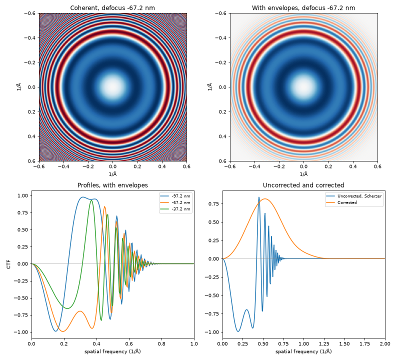

The contrast transfer function
==============================

The contrast transfer function (CTF) of an objective lens says how strongly, and with which
sign, each spatial frequency of a thin sample shows in its image.

.. seealso::

   Step 5 of the step-by-step guide, the notebook :doc:`probe.ipynb <../../notebooks/probe>`,
   explains the CTF and draws it, shown here with its plots and output.

:py:meth:`~pyemaps.probe.Probe.ctf` returns sin χ, damped by the temporal coherence envelope
(from *cc* and *energy_spread*) and the spatial one (from *semi_angle*), within 80% of the map's
radius. It isn't cut off at the aperture. ``scherzer(mode=2)`` sets the Scherzer defocus for
phase contrast, where the CTF keeps one sign out to the point resolution.

.. code-block:: python

   from pyemaps import Probe

   tem = Probe(kv=200, cs=1.2, cc=1.5, energy_spread=0.7, semi_angle=0.2,
               size=200, sampling=1024)
   tem.scherzer(mode=2)
   ctf = tem.ctf()

An uncorrected lens's CTF oscillates fast at high frequencies, so it needs fine reciprocal
pixels, that is, a large map: 200 Å gives 0.005 1/Å. The sample *ctf.py* shows the CTF with
and without the envelopes, at and around the Scherzer defocus, and for a corrected lens:

