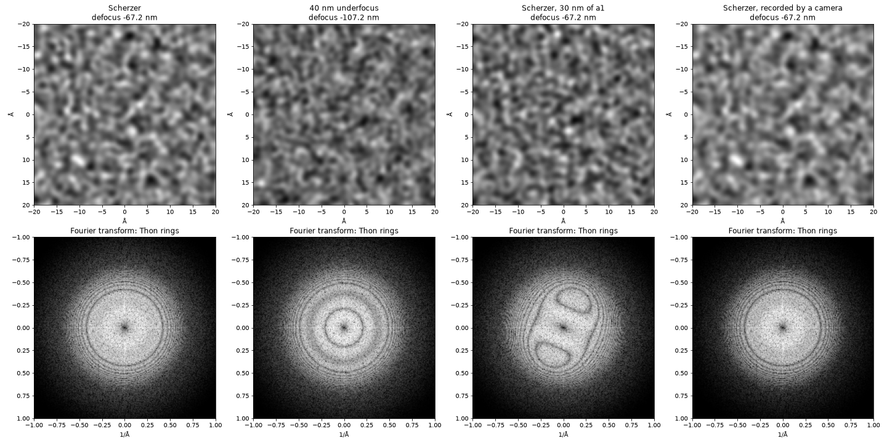

HREM images
===========

The high-resolution TEM (HREM) image of a thin sample, through the objective lens, and as a
camera records it.

.. seealso::

   Step 6 of the step-by-step guide, the notebook :doc:`probe.ipynb <../../notebooks/probe>`, makes
   HREM images from exit waves, shown here with its plots and output.

:py:meth:`~pyemaps.probe.Probe.hrem` images a sample's exit wave through the lens, used as the
objective lens: the aperture, the aberrations and the coherence envelopes. The direct beam
passes unchanged. :py:meth:`~pyemaps.probe.Probe.exit_wave` gives the exit wave of a thin sample
from its projected potential, and an exit wave from a multislice program works too. With
``integrate=True``, the images are added up over the energy spread instead of damped by the
temporal envelope.

.. code-block:: python

   from pyemaps import Probe

   tem = Probe(kv=200, cs=1.2, cc=1.5, energy_spread=0.7, semi_angle=0.2,
               size=100, sampling=512)
   tem.scherzer(mode=2)
   tem.aperture = 20.0                     # the objective aperture
   carbon = tem.random_potential(density=0.1, z=6, thickness=50, seed=7)
   image = tem.hrem(tem.exit_wave(carbon))
   tem.show(image, 'hrem')

A camera blurs the image it records. :py:meth:`~pyemaps.probe.Probe.apply_psf` applies a
detector's point spread function, through its transfer function ``a / (1 + b w²) + 1 - a`` at
w cycles per pixel, as the probe program's psf command did. The defaults, *a* = 0.6 and
*b* = 400, are typical of a camera: they transfer about 0.4 at the Nyquist frequency.

.. code-block:: python

   recorded = tem.apply_psf(image)                     # a=0.6, b=400.0
   sharper = tem.apply_psf(image, a=0.3, b=400.0)      # a better camera

The image of an amorphous sample shows the CTF in its Fourier transform, as Thon rings. The
sample *hrem.py* shows images at the Scherzer defocus, further underfocus, with two-fold
astigmatism, which makes the rings elliptical, and as a camera records them:

