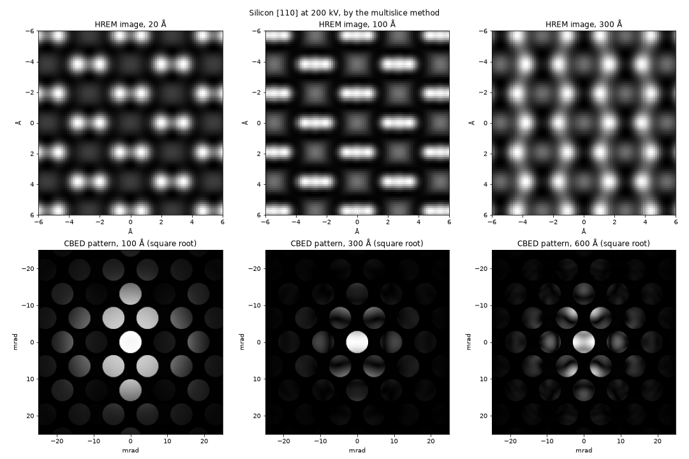

Thick crystals: the multislice method
=====================================

As a crystal gets thicker, the electron wave is scattered again and again on its way through
it, and the projected potential no longer tells the whole story. The multislice method follows
the wave through the crystal slice by slice (J. M. Cowley and A. F. Moodie; E. J. Kirkland,
*Advanced Computing in Electron Microscopy*). It's a licensed feature: it needs an active
pyEMAPS license, and raises :py:class:`~pyemaps.errors.LicenseError` without one. Run
``pyemaps -l trial`` for a 7-day trial license.

.. seealso::

   The notebook :doc:`si_multislice.ipynb <../../notebooks/si_multislice>` follows silicon through
   the thickness step by step: the projection against the multislice, the slice thickness and pixel
   size, thickness fringes checked against Bloch waves, and HREM and CBED thickness series.

.. toctree::
   :hidden:

   ../../notebooks/si_multislice

- :py:meth:`~pyemaps.probe.Probe.crystal_exit_wave`: the exit wave under plane-wave
  illumination; pass it to :py:meth:`~pyemaps.probe.Probe.hrem` for the HREM image.
- :py:meth:`~pyemaps.probe.Probe.crystal_ronchigram`: the probe's Ronchigram through the
  crystal; with a small aperture and the probe focused, a convergent-beam diffraction (CBED)
  pattern.

.. code-block:: python

   from pyemaps import Crystal, Probe

   si = Crystal.from_builtin('Silicon')
   a = float(si.cell.a)
   tem = Probe(kv=200, cs=-0.013, defocus=7.0, aperture=40.0, cc=1.5, energy_spread=0.7,
               semi_angle=0.2, size=12 * a, sampling=512)
   waves = tem.crystal_exit_wave(si, zone=(1, 1, 0), thickness=[20, 100, 300], fit=True)
   images = [tem.hrem(wave) for wave in waves]

A list of thicknesses gives the waves at each from one pass through the crystal. The crystal
repeats along the zone axis (``crystal_repeats()['period']``), so the slices of one repeat,
about *slice_thickness* = 2 Å each, serve for every repeat, and each thickness is rounded to a
whole number of slices. emaps computes everything: each slice's potential, from its atoms,
its transmission function, and the propagation between slices.

**Sampling.** The slices are band-limited to 2/3 of the map's largest spatial frequency,
``sampling / (2 * size)``, so their products don't alias. What the crystal scatters beyond
that is lost, and the wave's total intensity drops a little. Thick crystals need fine
pixels: with 0.13 Å pixels (512 over 65 Å), 200 Å of silicon keeps 99% of the intensity;
with 0.25 Å, 93%. A larger map makes finer angles in a CBED pattern or Ronchigram, since each
pixel there is ``1 / size``.

The beam is along the zone axis, and there is no absorption or thermal diffuse scattering. For
silicon [001], the beam intensities agree with emaps' Bloch-wave calculation, which includes
absorption, within 5% up to 200 Å.

The sample *crystal_thickness.py* shows silicon [110] at three thicknesses: the HREM images,
where the dumbbells turn into bars and then into a different pattern, and the CBED patterns,
where fringes appear inside the disks. Its silicon is a refined crystal structure from the
`Crystallography Open Database <https://www.crystallography.net>`_ (COD entry 2102763, public
domain), with its thermal factor, in a CIF file that comes with the sample. Its images match
the built-in model's closely, with correlations of 0.998 or better:

