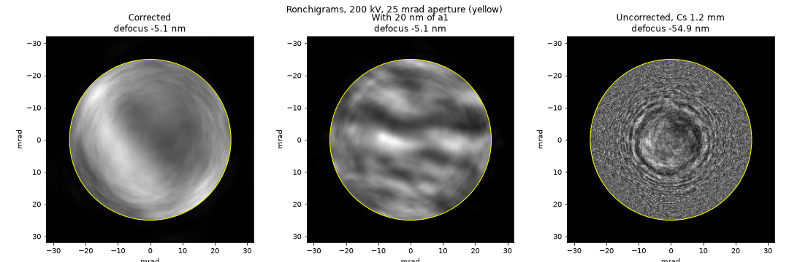

Ronchigrams
===========

A Ronchigram is the shadow image of a convergent probe through a thin amorphous sample: the
pattern correctors are aligned on.

.. seealso::

   Step 3 of the step-by-step guide, the notebook :doc:`probe.ipynb <../../notebooks/probe>`,
   explains and makes Ronchigrams, shown here with its plots and output.

:py:meth:`~pyemaps.probe.Probe.ronchigram` takes the sample's projected potential, a
*sampling* x *sampling* array. By default, it's
:py:meth:`~pyemaps.probe.Probe.random_potential`: 100 Å of amorphous aluminium, 0.05 atoms
per ų, with a fixed random number seed. Change the density, atomic number, thickness or seed
there, or pass a potential of your own.

.. code-block:: python

   from pyemaps import Probe

   corrector = {'a1': (1.349, 146.2), 'a2': (58.94, -131.9), 'b2': (22.89, 141.4)}
   lens = Probe(kv=200, aperture=25, defocus=-5.14, cs=-0.00355, c5=3.829,
                aberrations=corrector, size=100, sampling=256)    # see the lens page
   lens.show(lens.ronchigram(), 'ronchigram')

The map has to be large for the Ronchigram to reach beyond the aperture: 100 Å with 256 pixels
reaches 32 mrad at 200 kV. The sample *ronchigram.py* compares a corrected probe, the same with
two-fold astigmatism, and an uncorrected one, with the phase map behind each:

The Ronchigram doesn't include the chromatic aberration.
