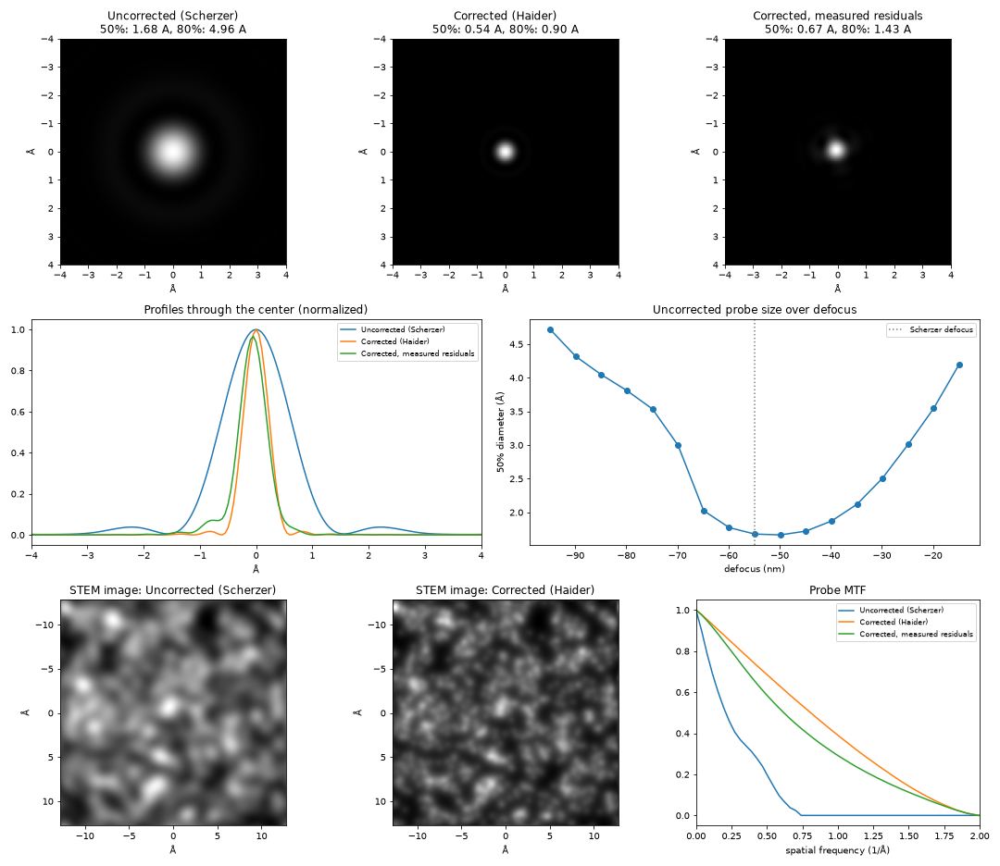

STEM probes and images
======================

The STEM probe's intensity in the sample plane and its size, the settings that make it
smallest, and the STEM images and transfer it gives.

.. seealso::

   Step 4 of the step-by-step guide, the notebook :doc:`probe.ipynb <../../notebooks/probe>`,
   computes the probe and its diameter, shown here with its plots and output.

:py:meth:`~pyemaps.probe.Probe.probe` returns the probe's intensity, normalized to a sum of 1.
With *cc* of 0.01 mm or more, it's the sum of the probes over the energy spread.
:py:meth:`~pyemaps.probe.Probe.diameter` gives the diameter of the circle holding a share of
the intensity. It counts whole pixels, so compute the probe on a map with pixels much smaller
than the probe, such as 0.05 Å:

.. code-block:: python

   from pyemaps import Probe

   fine = Probe(kv=200, aperture=25, c5=3.829, size=25.6, sampling=512)
   fine.haider(optimum_aperture=False)     # the Cs and defocus that balance C5 at 25 mrad
   print(f'{fine.diameter(50):.2f} Å')     # 0.54 Å

Two methods set the optimum settings:

- :py:meth:`~pyemaps.probe.Probe.scherzer` sets the Scherzer defocus and aperture of an
  uncorrected lens, from Cs;
- :py:meth:`~pyemaps.probe.Probe.haider` sets the Cs and defocus that balance C5 in a corrected
  lens, and the aperture too unless you keep yours, after Haider et al., *Ultramicroscopy*
  (2000).

:py:meth:`~pyemaps.probe.Probe.optimize` searches for the defocus and residual aberrations
that make the probe smallest, as the probe program's optimize command did, with the
Nelder-Mead simplex method. It minimizes the diameter as ``diameter(interpolate=True)``
measures it, interpolating between pixels so that it changes smoothly:

.. code-block:: python

   fine.set_aberration('a1', 15.0, 40.0)                   # 15 nm of two-fold astigmatism
   result = fine.optimize(percent=50, vary=('defocus', 'a1'))
   print(result['diameter'], result['a1'])                 # a1 tuned back to about 0

**STEM images.** :py:meth:`~pyemaps.probe.Probe.stem_image` gives the incoherent (annular dark
field) STEM image of a sample: the probe's intensity convolved with its projected potential.
:py:meth:`~pyemaps.probe.Probe.mtf` gives the probe's modulation transfer function, the
amplitude of the Fourier transform of its intensity, which says how strongly each spatial
frequency of the sample shows in such an image.

:py:meth:`~pyemaps.probe.Probe.focal_series` computes a probe, Ronchigram, CTF, HREM or STEM
image, or phase map at each of a list of defocus values, as a stack.

The sample *stem_probe.py* compares an uncorrected probe at its Scherzer settings with a
corrected one at the Haider settings, with and without a corrector's measured residual
aberrations. It shows the uncorrected probe's size across defocus, the STEM images of a thin
amorphous sample and the probes' MTFs, then tunes out the measured astigmatism with
:py:meth:`~pyemaps.probe.Probe.optimize`:

