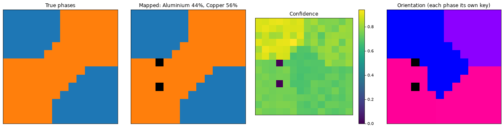

Phase mapping of a 4D-STEM scan
===============================

A phase map finds which of several crystal phases each pattern of a 4D-STEM scan belongs to,
and its orientation in that phase. It builds on :doc:`orientation`. This feature requires
:ref:`License Activation`.

.. seealso::

   The notebook :doc:`al_cu_phasemap.ipynb <../../notebooks/al_cu_phasemap>` maps the phases of a
   synthetic two-phase scan step by step, shown here with its plots and output.

.. toctree::
   :hidden:

   ../../notebooks/al_cu_phasemap

.. admonition:: Experimental
   :class: warning

   Phase mapping is experimental. It has been tested on synthetic two-phase scans of kinematic
   spot patterns, not yet on measured data, and its parameters, defaults and results may change
   in later releases.

:py:meth:`StackImage.mapPhases <pyemaps.stackimg.StackImage.mapPhases>` maps which of several
crystal phases each pattern of a scan belongs to. Make a database for each phase with
*generateDPDB*, as in :doc:`indexing`, then pass them by name:

.. code-block:: python

   pmap = scan.mapPhases({'Aluminium': al_db, 'Copper': cu_db}, cc=29.0, sigma=3.0,
                         img_center=(99.9, 99.9))
   print(pmap)                  # each phase's share, and how many patterns are ambiguous
   pmap.show()                  # the phases; grey where ambiguous
   pmap.show('confidence')
   pmap.show('ipf')             # each pattern's orientation, from its phase's map
   pmap.save('scan_phases.npz')

It indexes every pattern against each phase's database, as *mapOrientation* does against one,
so it takes as long as one orientation map per phase, and it takes the same parameters. The
result, a :py:class:`~pyemaps.phasemap.PhaseMap`, holds each phase's orientation map too.

Indexing alone can't tell phases apart: it matches the angles and length ratios of the peaks, so
a database also indexes the patterns of a phase with a similar structure. Aluminium and copper,
both FCC with lattice constants 4.05 and 3.61 Å, give the same angles 12% apart in scale, and
each one's database indexes most of the other's patterns. emaps decides with the peaks'
distances from the pattern centre instead: with the camera constant *cc*, they match one
phase's reflection spacings and not the other's. This **spacing score** needs no orientation.
Each phase is also scored on its indexing, the share of the peaks it explains and of its
predicted reflections found, but by default (*orientation_weight* 0) only the spacing score
decides: on synthetic scans it was the more reliable of the two. Raise *orientation_weight* for
phases whose reflection spacings coincide.

A pattern's **confidence** is how far its phase leads the second best. Below *min_confidence*
(0.2) the pattern is ambiguous, grey on the map; patterns without peaks have no phase and are
black. On six synthetic scans of aluminium with copper and of aluminium with silicon, 78 to 98%
of the patterns were decided, and every decided pattern had the right phase.

The spacing score is only as good as the camera constant and the pattern centre: a peak counts
within *spacing_tol* (1 pixel) of a reflection spacing. Calibrate them on a known pattern first,
and check the map's ambiguous patterns.

The sample *al_cu_phasemap.py* maps a synthetic scan of five aluminium and copper grains and
compares the map with the truth: 194 of the 196 patterns are decided, all correctly; the two left
have no peaks the search could find. Its crystal structures are refined ones from the
`Crystallography Open Database <https://www.crystallography.net>`_ (COD entries 4004108 and 7101269,
public domain), with their thermal factors, in CIF files that come with the sample. The notebook
:doc:`al_cu_phasemap.ipynb <../../notebooks/al_cu_phasemap>` walks through the same run step by
step, including why the indexing alone can't tell the two phases apart; ``pyemaps -cp notebooks``
copies it to run yourself.

