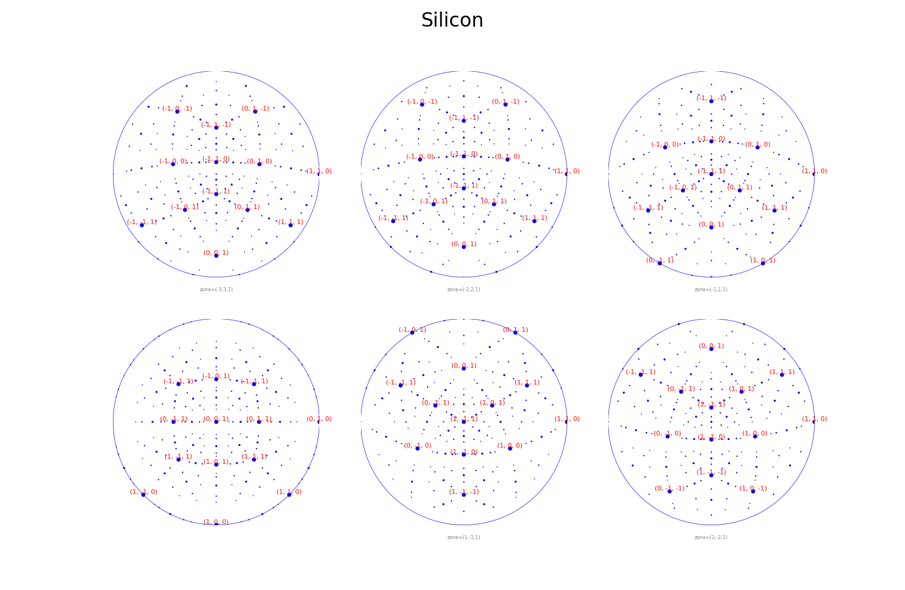

Stereodiagrams
==============

:py:meth:`~pyemaps.crystals.Crystal.generateStereo` calculates a crystal's stereodiagram: the
projected poles, each a dictionary with its center, radius and Miller indices.
:py:func:`~pyemaps.display.showStereo`, from the :py:mod:`display module <pyemaps.display>`,
draws a list of stereodiagrams.

This example makes Silicon stereodiagrams at six zone axes, in parallel processes, and shows
them as a table:

.. code-block:: python

    import concurrent.futures
    from pyemaps import EMC
    MAX_PROCWORKERS = 4

    def getStereo(cc, emc = EMC()):
        
        stereo = cc.generateStereo(zone = emc.zone)
        return emc, stereo
        
    def generate_stereo_list(name = 'Silicon'):  
        from pyemaps import Crystal as cr
        
        si = cr.from_builtin(name)
        emclist = []
        
        for i in range(-3,3): 
            emclist.append(EMC(zone=(i,-i,1)))
        
        fs = []
        slist=[]
        with concurrent.futures.ProcessPoolExecutor(max_workers=MAX_PROCWORKERS) as e:
            
            for ec in emclist:
                fs.append(e.submit(getStereo, si, emc=ec))

            for f in concurrent.futures.as_completed(fs):
                try:
                    emc, stereo = f.result()               
                except Exception as e:
                    print('failed to generate stereodiagram with ' + str(e))
                    exit(1)
                else:
                    slist.append((emc, stereo))    
        
        slist.sort(key=lambda x: x[0])
        return slist

    if __name__ == '__main__':
        
        from pyemaps import showStereo
        
        stereoList = generate_stereo_list()
        showStereo(stereoList, 
                name='Silicon', 
                cShow = True,
                iShow=True, 
                zLimit = 1,
                layout='table')

