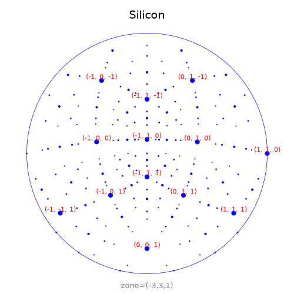
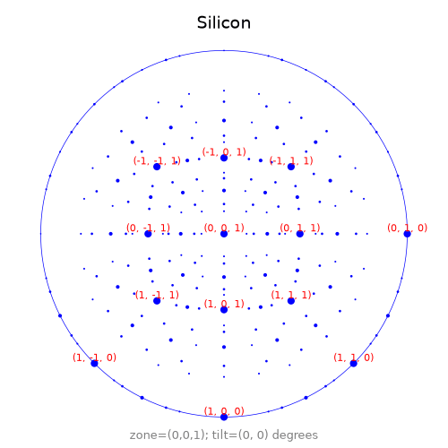

Stereodiagrams
==============

:py:meth:`~pyemaps.crystals.Crystal.generateStereo` calculates a crystal's stereodiagram: the
projected poles, each a dictionary with its center, radius and Miller indices.
:py:func:`~pyemaps.display.showStereo`, from the :py:mod:`display module <pyemaps.display>`,
draws a list of stereodiagrams.

This example makes Silicon stereodiagrams at six zone axes, in parallel processes, and shows
them as a table. The animation below shows the six, one after another:

.. code-block:: python

    import concurrent.futures
    import sys

    from pyemaps import EMC, Crystal, showStereo

    MAX_WORKERS = 4    # number of parallel processes

    def stereodiagram(crystal, emc):
        """Return `emc` and the crystal's stereodiagram at the zone axis in `emc`."""
        return emc, crystal.generateStereo(zone=emc.zone)

    def generate_stereodiagrams(name='Silicon'):
        """Generate stereodiagrams at six zone axes, in parallel."""
        crystal = Crystal.from_builtin(name)
        emc_list = [EMC(zone=(i, -i, 1)) for i in range(-3, 3)]

        stereo_list = []
        with concurrent.futures.ProcessPoolExecutor(max_workers=MAX_WORKERS) as executor:
            futures = [executor.submit(stereodiagram, crystal, emc) for emc in emc_list]

            for future in concurrent.futures.as_completed(futures):
                try:
                    stereo_list.append(future.result())
                except Exception as e:
                    sys.exit(f'Failed to generate a stereodiagram: {e}')

        stereo_list.sort(key=lambda pair: pair[0])    # sort by the microscope controls
        return stereo_list

    if __name__ == '__main__':
        showStereo(generate_stereodiagrams(), name='Silicon',
                   cShow=True, iShow=True, zLimit=1, layout='table')

.. The animations on this page are made by docs/scripts/guide_animations.py.

Tilting the sample
------------------

*tilt* tilts the sample about the x and y axes, in degrees, and the poles move across the
projection as the crystal turns:

.. code-block:: python

    from pyemaps import EMC, Crystal, showStereo

    si = Crystal.from_builtin('Silicon')
    tilts = [(-20.0, 0.0), (-10.0, 0.0), (0.0, 0.0), (10.0, 0.0), (20.0, 0.0)]
    stereo_list = [(EMC(tilt=t), si.generateStereo(zone=(0, 0, 1), tilt=t))
                   for t in tilts]
    showStereo(stereo_list, name='Silicon', iShow=True, zLimit=1)

The animation tilts Silicon at the [001] zone axis about x, from 0 to 20 degrees, to -20 and
back, then the same about y:

